# Mochammad Bisma Prasetya

**Software Developer** &nbsp;·&nbsp; Python, Flask, PostgreSQL, React &nbsp;·&nbsp; ICT Spindo

---

### Tentang

Software Developer di ICT PT Steel Pipe Industry of Indonesia (Spindo), lulusan S1 Informatika dengan pengalaman membangun aplikasi secara menyeluruh, dari backend hingga antarmuka. Fokus saya adalah kode yang mudah dirawat, teruji, dan aman: setiap aplikasi dilengkapi kontrol akses berbasis peran, audit log, serta verifikasi OTP, dan dipindai untuk menutup celah umum seperti XSS dan SQL injection.

Tersertifikasi BNSP dan terbuka untuk kerja sama remote.

### Teknologi

| Bidang | Alat |
|---|---|
| Backend | Python, Django, Flask, PHP, Laravel, CodeIgniter |
| Frontend & Mobile | JavaScript, React, Tailwind CSS, Flutter, HTML, CSS |
| Basis Data | PostgreSQL, MySQL, MongoDB, Firestore |
| Pengujian & Keamanan | Pytest, OWASP ZAP, RBAC, OTP, audit log |
| Tooling | Git, GitLab CI, PowerShell, VS Code |

### Proyek Unggulan

**ALR — Access Link Register.** Aplikasi web yang menyatukan link akses ICT yang sebelumnya tersebar ke dalam satu tempat, lengkap dengan petunjuk dan kredensialnya. Dibangun dengan Flask dan PostgreSQL di sisi backend serta React di sisi antarmuka, dengan login dua langkah (email korporat dan OTP), peran Admin dan User Entry, pemisahan data publik dan privat, serta audit log yang tidak dapat diubah.

Simulasi aturan aksesnya dapat dicoba langsung pada [portofolio interaktif](https://masbismaa.github.io/Masbismaa/).

### Aktivitas

Test dulu, baru push.

