# Mochammad Bisma Prasetya

**Software Developer** · ICT PT Steel Pipe Industry of Indonesia Tbk

---

Saya membangun aplikasi web dari backend hingga antarmuka, dengan fokus pada kode yang mudah dirawat, teruji, dan aman.
Lulusan S1 Informatika, tersertifikasi BNSP, dan terbuka untuk kerja sama remote.

### Tech Stack

### Proyek Unggulan

**[ALR — Access Link Register](https://masbismaa.github.io/Masbismaa/)**
Satu tempat untuk semua link akses ICT beserta petunjuk dan kredensialnya. Flask + PostgreSQL + React, login dua langkah (email korporat & OTP), kontrol akses berbasis peran, dan audit log yang tidak dapat diubah.

### Statistik

